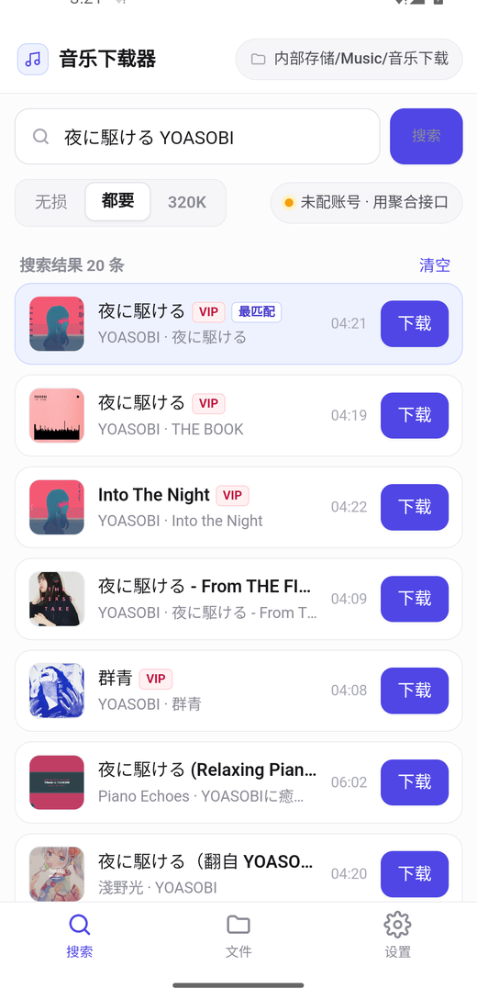
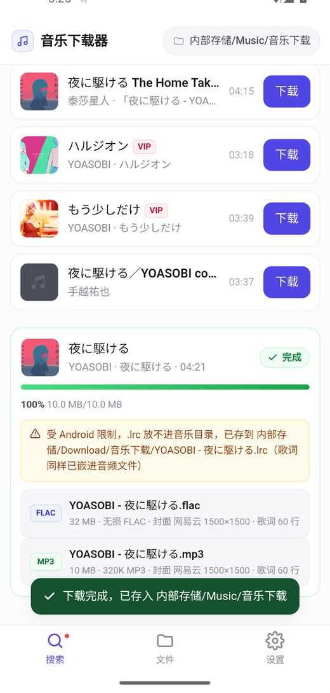
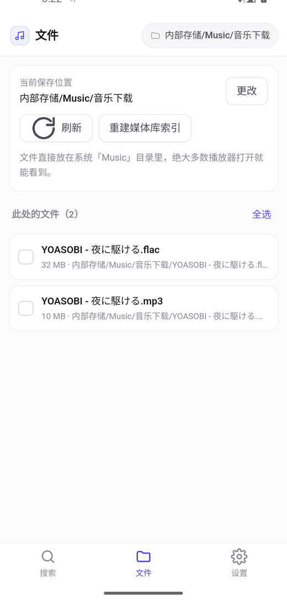
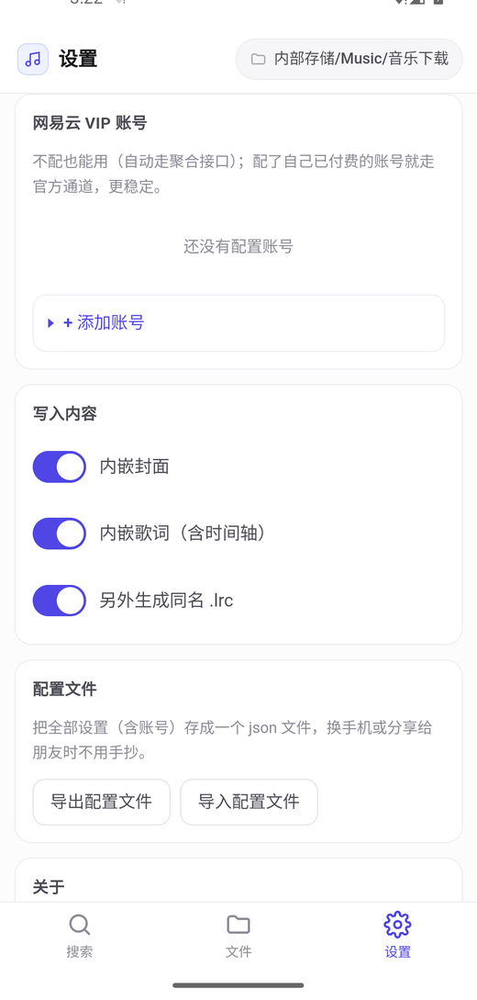

<div align="center">


# 音乐下载器 · Android 版

**下载完就能直接听 —— 不用再手动把文件挪进 Music 文件夹**

白色简约风，开箱即用。下载无损 FLAC / 320K MP3 的同时，自动写入封面、双语时间轴歌词、专辑歌手等完整标签。

[**⬇ 一键下载 APK**](https://github.com/nishicouqie/music-downloader-android/releases/latest/download/music-downloader-android.apk)　·　[**🌐 项目主页**](https://nishicouqie.github.io/music-downloader-android/)　·　[**💻 电脑版**](https://github.com/nishicouqie/music-downloader)　·　[常见问题](#常见问题)

　　

</div>

---

## 它解决什么问题

手机上下载音乐最烦的不是下载本身，而是**下载完之后找不到**：

- 文件被塞进应用私有目录，或者乱七八糟的 `Download/` 里
- 手机自带的文件管理器难用到爆，挪个文件要点十几下
- 音乐播放器只扫 `Music/` 目录，你在别处下的歌它根本看不见
- 就算找到了，也多半是「未知艺术家 + 没有封面 + 没有歌词」

**这个 App 直接把文件写进系统的 `Music/音乐下载/` 目录**，并通过 MediaStore 登记，
所以你常用的音乐播放器打开就能扫到，不需要任何手动搬运。

如果有些歌是你从微信、浏览器等别处下载的，App 里的「文件」页也能扫出来，勾一下就能搬进 Music。

## 特性

| | |
|---|---|
| 📁 **直接存进 Music 目录** | 播放器立刻能扫到，不用手动挪文件，也不用给「所有文件访问权限」 |
| 🔀 **内置文件搬运** | 别处下载的歌，勾选后一键移进 Music；也能自己选任意保存目录 |
| ⚙️ **配置文件导出/导入** | 全部设置（含 VIP 账号）存成一个 json，换手机不用手抄 |
| 🎧 **最高音质** | 优先无损 FLAC，实测拿到过 96kHz/24bit 的 Hi-Res；也可选 320K MP3 |
| 🖼 **封面自动挑最清晰的** | 网易云和 iTunes 里同时找，取分辨率最高的那张 |
| 🎵 **歌词带完整时间轴** | 日文原词 + 中文翻译合并成双语 LRC；MP3 额外写入 SYLT 逐行同步歌词 |
| 🔑 **VIP 账号像 API Key 一样管理** | 可存多组、随时切换，带一键有效性测试 |
| 📊 **进度看得见** | 百分比、速度、剩余时间，七步流程指示器 |
| 💬 **报错说人话** | 每条错误都给「原因 + 该怎么办」，可展开技术细节 |
| 🔁 **三级音源降级** | 官方 VIP 通道 → 聚合接口 → 兜底源，逐级自动重试 |
| 🪶 **体积小** | APK 只有 0.7 MB，不依赖任何第三方库 |

## 快速开始

1. 点上面的「一键下载 APK」，或到 [Releases](https://github.com/nishicouqie/music-downloader-android/releases/latest) 下载 `music-downloader-android.apk`
2. 手机上打开这个 APK，按提示允许「安装未知来源应用」
3. 装好后打开 App，搜歌 → 点「下载」
4. 完成后的文件在 **`内部存储/Music/音乐下载/`**，任何音乐播放器都能扫到

> **首次安装会被系统提示「未知来源应用」**，因为 APK 不是从应用商店装的。这是正常现象，
> 允许一次即可。App 没有申请任何敏感权限——写 `Music/` 目录在 Android 10 以上不需要权限。

**系统要求**：Android 7.0（API 24）及以上。

## 截图

<div align="center">
　
<br><sub><b>搜索</b>：封面缩略图、VIP 标记、自动标出最匹配的一条　·　<b>下载完成</b>：列出每个文件实际写入了什么</sub>
<br><br>
　
<br><sub><b>文件</b>：直接展示 Music 目录里的内容，可多选搬运　·　<b>设置</b>：多组账号 + 配置文件导入导出</sub>
</div>

## 设置 VIP 账号（可选）

不配也能用，会自动走第三方聚合接口。但如果你有网易云黑胶 VIP，配上账号就能走**官方通道**，
更稳定、更合规，也是你的正当权益。

**最省事的办法**：在电脑上用[桌面版](https://github.com/nishicouqie/music-downloader)配好账号，
然后「导出配置文件」，把 json 传到手机上，用本 App 的「设置 → 导入配置文件」读进来，账号会一起带过来。

也可以手动填：拿到 `MUSIC_U` 的值 → 设置 → 添加账号 → 粘贴 → 保存。
保存后点「测试」，App 会当场验证这个 Cookie 是否有效、是什么会员等级、**能不能真的取到无损直链**。

> Cookie 只保存在本机，不会发往任何第三方。

## 音源是怎么取的

```
① 官方 VIP 通道    music.163.com/api/song/enhance/player/url/v1  + 你自己的 MUSIC_U
                    level=hires → lossless（无损）；exhigh（320K）
② 聚合接口         music-api.gdstudio.xyz   br=999 / 320
③ 兜底源           gequbao.com             仅酷我 128K，界面上会明确标注
```

逐级自动降级，每一级的失败原因都会记录下来一起展示。

## 标签是内置引擎写的

**没有用 jaudiotagger 之类的库** —— 那个库处理封面时依赖 `java.awt`，而 Android 没有 `java.awt`，
跑起来会直接崩。所以本项目自己实现了两套写入器：

- **MP3** → ID3v2.3（UTF-16 文本）
  `TIT2` `TPE1` `TALB` `TPE2` `TRCK` `TPOS` `TYER` `TDAT` `TCON` `TENC` `COMM`
  `APIC`(封面) `USLT`(双语歌词) `SYLT`(逐行时间轴) `TXXX:SOURCE`
- **FLAC** → Vorbis Comment + PICTURE 元数据块
  `TITLE` `ARTIST` `ALBUM` `ALBUMARTIST` `TRACKNUMBER` `TRACKTOTAL` `DISCNUMBER`
  `DISCTOTAL` `DATE` `GENRE` `COMMENT` `SOURCE` `LYRICS` `UNSYNCEDLYRICS`
  `LYRICS_ORIGINAL` + 封面

产物用 Python 的 `mutagen` 交叉验证过，格式完全合规：

```
MP3   USLT 120 行 / SYLT 60 条（时间轴单调递增）/ APIC 135 KB
FLAC  lyrics 137 行 / PICTURE 1500×1500
两者 ffmpeg 整轨解码均无错误
```

## 关于 .lrc 旁挂文件

Android 11 起，第三方应用**不允许把非媒体文件写进 `Music/` 目录**，系统会直接拒绝：

```
Primary directory Music not allowed for content://media/external/file;
allowed directories are [Download, Documents]
```

所以：

- **歌词本身照常可用** —— 已经嵌进音频文件的 `USLT` / `LYRICS` 里，任何主流播放器都能显示
- **旁挂 `.lrc`** 会自动退到 `内部存储/Download/音乐下载/`，并在界面上明确告诉你放在哪
- 如果你希望 `.lrc` 和音乐放在一起，可以在设置里用「自己选一个目录」把保存位置指定成任意
  一个通过系统选择器授权的文件夹（SAF 模式下没有这个限制）

## 从源码构建

需要 JDK 17 + Android SDK（platform 34 + build-tools 34）。

```bash
git clone https://github.com/nishicouqie/music-downloader-android.git
cd music-downloader-android
echo "sdk.dir=/path/to/AndroidSdk" > local.properties
./gradlew assembleRelease
# 产物：app/build/outputs/apk/release/app-release.apk
```

**注意**：项目路径不能包含非 ASCII 字符，否则 Android Gradle Plugin 会直接拒绝构建
（Windows 上尤其常见）。放到 `D:\android-build\` 这种纯英文路径下即可。

仓库里带了签名用的 keystore（`keystore/musicdl.jks`，口令 `musicdl2026`），
这样任何人都能复现出**签名一致**的 APK，方便覆盖安装升级。这是个自签名密钥，
公开发布没有安全意义，所以直接放在仓库里。

## 常见问题

<details>
<summary><b>装完打开，播放器还是找不到歌？</b></summary>

先确认文件确实在 `内部存储/Music/音乐下载/`（App 的「文件」页能看到就说明在）。
然后在「文件」页点一下「重建媒体库索引」，让系统重新扫描一次。
部分播放器有自己的媒体库缓存，需要在其设置里手动「重新扫描」。

</details>

<details>
<summary><b>提示「所有音源通道都没能取到直链」？</b></summary>

三级通道全挂了。常见原因是第三方聚合接口临时限流或停止服务，或者这首歌要付费购买。
点「重试」；到设置里点账号的「测试」检查 Cookie 是否还有效；长期不可用就配一个自己的 VIP 账号。

</details>

<details>
<summary><b>只有 128K，拿不到无损？</b></summary>

界面上会显示实际拿到的音质。显示「酷我 128K」说明前两级都没成功，降级到了兜底源。
配一个网易云黑胶 VIP 账号走官方通道即可。

</details>

<details>
<summary><b>为什么有些歌没有歌词？</b></summary>

歌词来自网易云。刚发布不久的新歌、纯音乐、冷门曲目在网易云本身就还没有歌词，
这时 App 会明确提示「这首歌没有时间轴歌词」，音频和封面照常下载。

</details>

<details>
<summary><b>会封号吗？</b></summary>

正常使用频率下没有发现问题。但请不要高频批量抓取——既可能触发风控，也会给第三方服务造成负担。

</details>

<details>
<summary><b>能改保存位置吗？</b></summary>

可以。设置 → 保存位置 → 「自己选一个…」，用系统文件夹选择器挑任意目录。
也可以只改 `Music/` 下的子目录名（默认 `音乐下载`）。

</details>

## 免责声明

- 本工具仅供**个人学习与技术研究**使用，请勿用于商业用途或大规模分发。
- 请**只下载你有权获取的内容**。通过第三方接口获取需要付费的会员内容属于灰色地带，
  由此产生的一切后果由使用者自行承担。
- 推荐的做法是配置你自己**已经付费购买**的 VIP 账号，走官方通道下载。
- 第三方接口（`music-api.gdstudio.xyz`、`gequbao.com`）与本项目无关，其可用性随时可能变化。
- 本项目不包含、不托管任何音乐文件。

## 相关项目

| 版本 | 说明 |
|---|---|
| [**电脑版（Windows）**](https://github.com/nishicouqie/music-downloader) | 白色简约桌面应用，功能一致，支持命令行批量下载 |
| **Android 版**（本仓库） | 手机端，直接存进 Music 目录，内置文件搬运 |

## License

[MIT](LICENSE)
